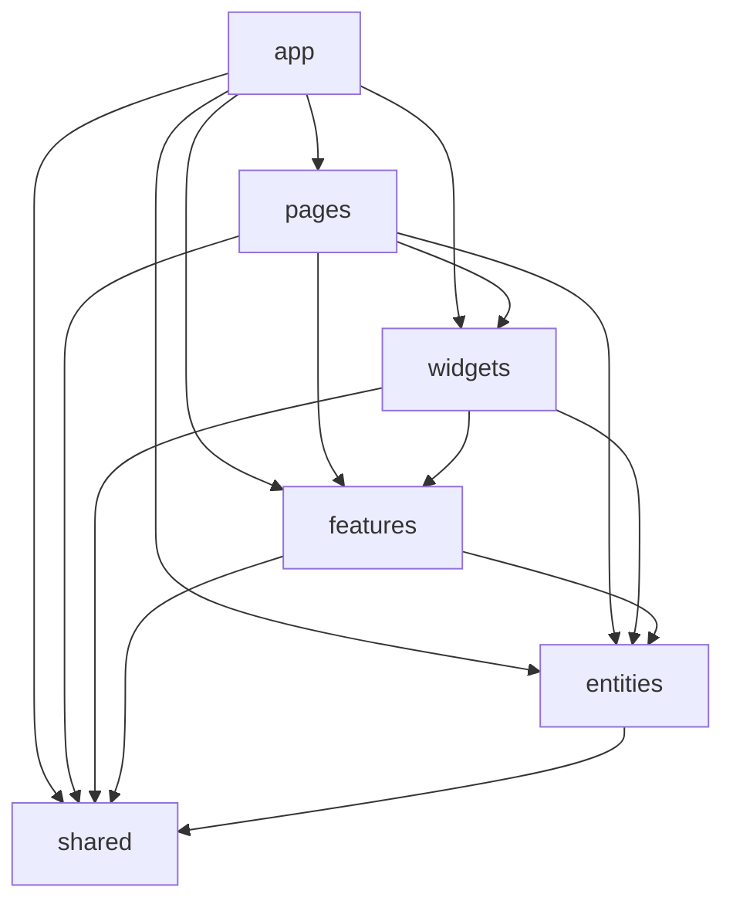

# vue-lottery-app

Лабораторні №4-6: застосунок на Vue 3 (Composition API + TypeScript).
Лабораторна №5 виконана в гілці `feature/routing`, лабораторна №6 - у гілці `feature/fsd`.

## Запуск

```bash
npm install
cp .env.example .env     # на Windows PowerShell: copy .env.example .env
npm run dev              # http://localhost:5173
npm run build            # перевірка типів (vue-tsc) + збірка
npm run lint             # ESLint (Vue style guide + правила FSD)
npm run lint:fsd         # лише правила Feature-Sliced Design
npm run deploy           # збірка і публікація dist/ у гілку gh-pages
```

Налаштування середовища зберігаються у `.env` (файл не комітиться, у репозиторії лише `.env.example`):

| Змінна                          | Призначення                              |
| ------------------------------- | ---------------------------------------- |
| `VITE_API_URL`                  | базова адреса REST API (DummyJSON)       |
| `VITE_APP_TITLE`                | назва застосунку (заголовок вкладки)     |
| `VITE_ACCESS_TOKEN_TTL_MINUTES` | час життя accessToken у хвилинах         |

Тестовий акаунт для входу: `emilys` / `emilyspass` ([DummyJSON](https://dummyjson.com/docs/auth)).

## Що реалізовано

**Лабораторна №5** (збережено без регресій): ліниві маршрути, `/users/:id` і вкладений `/users/:id/edit`,
404, layouts через `meta.layout`, пагінація й пошук через query-параметри, CRUD користувачів (DummyJSON лише
імітує запис, тому локальний стан оновлюється самостійно), JWT-авторизація з refresh при 401, guard
`requiresAuth`, VeeValidate + Yup.

**Лабораторна №6**:

- архітектура **Feature-Sliced Design** (шари `app`, `pages`, `widgets`, `features`, `entities`, `shared`), alias `@` -> `src`;
- правила FSD перевіряє `eslint-plugin-boundaries` (`npm run lint:fsd`): напрямок залежностей, заборона імпортів між слайсами одного шару, імпорт лише через Public API (`index.ts`), заборона прямих імпортів PrimeVue поза `shared/ui` та `app/providers/ui.ts`;
- **Pinia** (setup stores, `storeToRefs`): `useSessionStore`, `useUsersStore`, `useWinnersStore`, `useThemeStore`;
- **PrimeVue** (тема Aura, основний колір `#3bafda`, імпорт окремих компонентів) з обгортками в `shared/ui`: `AppButton`, `AppInput`, `AppSelect`, `AppTable`, `AppConfirmDialog`, `AppMessage`, `AppSpinner`, `AppPagination`, `AppSearchInput`, `AppToast` + `useNotify` (toast-сповіщення про результат операцій);
- Repository розподілено по шарах (див. нижче);
- перемикач світлої/темної теми (`features/theme-switcher`), що зберігається плагіном `pinia-plugin-persistedstate`.

## Структура (FSD)

```
src/
  app/        main.ts, App.vue, layouts, styles, providers/{router, services.ts, store.ts, ui.ts}
  pages/      home, about, login, users, user-details, user-create, user-edit, not-found
  widgets/    app-header (AppHeader, AppNavigation, AppLogo), users-table, winners-block
  features/   auth (LoginForm, LogoutButton), user-form, theme-switcher
  entities/   user (types, UserService, store), session (AuthService, store), winner (store)
  shared/     api (http-client, інтерфейси Repository, ServiceProvider), ui, lib, config
```

### Діаграма залежностей шарів

Стрілка означає «може імпортувати з». Слайси одного шару одне від одного не залежать.



## Repository у FSD

| Частина                                                   | Розташування                         |
| --------------------------------------------------------- | ------------------------------------ |
| HTTP-клієнт, `Readable`, `Creatable`, `Editable`, `Deletable` | `shared/api`                     |
| `ServiceProvider` (універсальний реєстр `register` / `get`) | `shared/api`                       |
| `User`, `CreateUserDto`, `UpdateUserDto`                  | `entities/user/model`                |
| `UserService`                                             | `entities/user/api`                  |
| `AuthService`, типи сесії                                 | `entities/session/api`, `.../model`  |
| Реєстрація `UserService` і `AuthService`                  | `app/providers/services.ts`          |

`shared` не може залежати від `entities`, тому `ServiceProvider` не імпортує конкретні сервіси: вони
реєструються на рівні `app`, а стори отримують їх через `ServiceProvider.get<UserService>('users')`.

## Збереження стану: вручну чи pinia-plugin-persistedstate

- **`session` store - вручну** (функція `persist()` у `session.store.ts`). Плюси: повний контроль - перевірка
  формату збережених даних при читанні (`loadStoredSession`), у `localStorage` потрапляє лише мінімум даних
  користувача, формат ключа `vue-lottery-auth` сумісний з ЛР5. Мінуси: більше коду, а `persist()` потрібно
  викликати в кожному місці, де змінюється сесія.
- **`theme` store - плагіном** (`persist: { key, pick: ['mode'] }`). Плюси: декларативно, один рядок
  конфігурації, `pick` обирає поля, відновлення стану робиться автоматично. Мінуси: плагін не валідує
  збережені дані без додаткових хуків (`beforeHydrate`, власний `serializer`) і записує вибрані поля при кожній
  зміні, тому для токенів доступу ручна реалізація зручніша, а для простих налаштувань (тема) - плагін.

## Деплой на GitHub Pages

```bash
git switch feature/fsd
npm run deploy
```

Потім у GitHub: Settings -> Pages -> Source: `gh-pages` / `/ (root)`.
